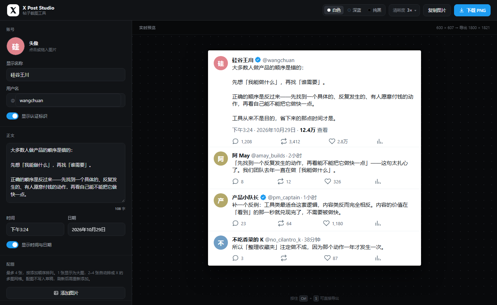

# X Post Studio

把一段文字，做成一张和 X（Twitter）一模一样的帖子截图。

填昵称、用户名、正文和各项数据，右侧实时预览，一键导出 3× 高清 PNG。
适合做观点卡片、内容存档、帖子备份、演示素材。



## 功能

- **完整字段可调**：头像、显示名称、用户名、正文、评论数、转发数、点赞数、浏览量
- **@提及 / #话题 / 链接自动变蓝**：正文和评论里写 `@username`、`#话题`、`https://...`，会按 X 的样式标成品牌蓝（#1d9bf0）；邮箱 `a@b.com` 不会被误标
- **配图**：最多 4 张。1 张按原比例显示（超过 510px 高则居中裁剪），2 张左右并排，3 张左大右两小，4 张 2×2，间距 2px、圆角 16px，与 X 一致
- **评论区**：在主帖下方追加任意条回复，每条独立设置头像、名称、用户名、正文、时间、点赞/转发/回复数、认证标识；顺序即显示顺序，可单独折叠或删除
- **引用转发**：把另一条帖子做成 X 的引用卡片，嵌在主帖正文下方——独立设置头像、名称、用户名、认证、正文、时间，边框和圆角按 X 还原
- **一键清空**：清成一张白纸，从零写自己的内容；点「撤销」可恢复
- **撤销**：清空、恢复示例、增删评论都能撤回，最多 40 步；快捷键 `Ctrl/⌘ + Z`（在输入框里交给浏览器原生撤销）
- **三种官方配色**：白色 / 深蓝（Dim）/ 纯黑（Lights out）
- **数字自动换算**：填 `28000` 自动显示成 `2.8万`，也可以直接写 `2.8万`、`28K`
- **头像**：点击上传、拖拽进来、或者直接粘贴剪贴板里的图片；自动裁成方形并压到 320px
- **画布宽度可调**：420–820 px，适应不同尺寸的展示位
- **导出清晰度**：2× / 3× / 4×，600 宽的卡片 3× 导出为 1800 px
- **复制图片**：直接粘进微信、飞书、文档
- **自动存草稿**：刷新不丢，所有内容留在本机

## 使用

直接双击 `index.html`，或起一个本地服务：

```bash
python -m http.server 8000
# 打开 http://localhost:8000
```

快捷键：`Ctrl/⌘ + S` 导出，`Ctrl/⌘ + Z` 撤销。

评论区操作：点条目所在行展开或收起，点右上角 `×` 删除，点「添加一条评论」追加到末尾。

配图操作：点「添加图片」可一次多选，按选择顺序编号排列，缩略图右上角 `×` 移除。满 4 张后按钮自动隐藏。

引用转发：打开「显示引用卡片」后填写被引用帖子的信息。真实 X 上引用卡片与配图二选一，这里不做强制，两者都填会依次显示。

## 几处刻意的取舍

- **配图不写入草稿**：图片体积大，几张就可能撑爆浏览器的 5MB 配额，届时整份草稿都会存不进去。所以刷新页面后需要重新添加配图，文字和头像不受影响。
- **撤销不含配图**：快照只存文字与结构（几张 base64 堆 40 份会吃掉几百 MB 内存），撤销时保留当前配图不变。
- **配图压到长边 1600px**：600 宽卡片按 3× 导出时，图片区域约 1700px，这个尺寸基本不损清晰度，同时把单张体积控制在几百 KB。
- **导出会自己降倍**：浏览器 canvas 有硬上限（单边 16384px、总面积约 1.6 亿像素）。正文很长、配图很多时，4× 会撞上限并得到一张白图，所以导出前会先算一遍，超了就自动降到能安全导出的倍数，并在提示里告诉你实际用了多少。

## 部署

纯静态，扔到任何静态托管上就能用，不需要构建、不需要后端。

- **GitHub Pages**：仓库 Settings → Pages → Source 选 `Deploy from a branch`，分支选 `main`、目录选 `/ (root)`，保存后等一两分钟，地址是 `https://<你的用户名>.github.io/<仓库名>/`。
- **Vercel / Netlify / Cloudflare Pages**：导入仓库，构建命令留空，输出目录填 `.`，直接部署。
- **自己的服务器**：把整个目录丢进任意 web 根目录即可。

部署完记得改 `index.html` 里的 `og:image`：现在写的是相对路径 `./assets/og-cover.png`，多数平台抓分享卡片时要求绝对地址，换成 `https://你的域名/assets/og-cover.png` 才能显示缩略图。

## 结构

```
index.html            页面骨架
assets/style.css      编辑器 UI + 帖子卡片的保真样式
assets/app.js         状态、渲染、导出
assets/vendor/        html2canvas（本地副本，离线也能导出）
assets/screenshot.png README 用界面截图
assets/og-cover.png   分享卡片缩略图（1200×630）
```

## 实现说明

- 零框架、零构建，纯静态文件
- 导出优先用 html2canvas；加载失败时自动降级为 SVG `foreignObject` 渲染，断网也能出图
- 所有处理都在浏览器本地完成，图片和文字不会上传到任何服务器

## 注意

这是排版工具，不是内容生成工具。请只用于你自己的内容或已获授权的素材，
不要用来伪造他人言论或制造虚假信息。

## 许可

[MIT](LICENSE)。随意 fork、改、商用，保留版权声明即可。
